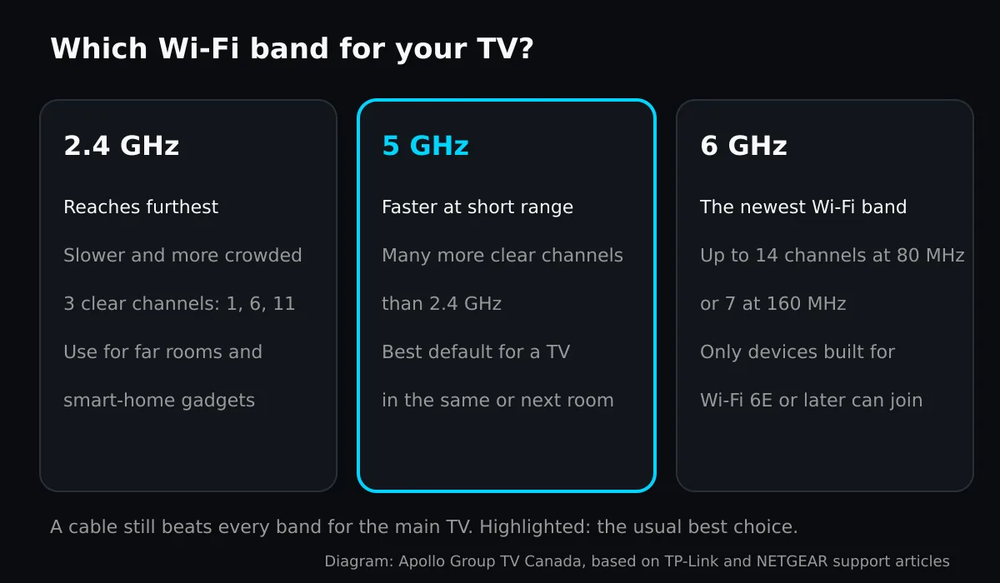
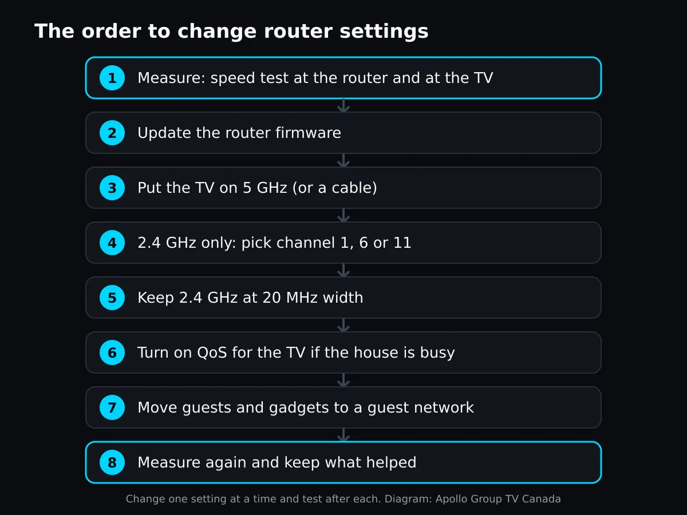

The router settings that help streaming most are, in order: current firmware, the TV on the 5 GHz band (or a cable), a clear 2.4 GHz channel (1, 6 or 11) at 20 MHz width, and Quality of Service (QoS) that gives the TV priority when the house is busy. Change one setting at a time, and run a speed test before and after each change so you keep only what helps.

This guide explains each setting in plain language, shows where router makers put it, and tells you which changes are worth your time and which rarely make a difference. It complements our guides on [Wi-Fi or Ethernet for streaming](/guides/wifi-vs-ethernet/) and [fixing buffering](/guides/fix-buffering/): those cover the cable and the quick fixes, this one covers the router itself.

**Contents**

- [Which router settings help streaming most?](#at-a-glance)
- [How do you know if the router is the problem?](#measure)
- [1. Why update the router firmware first?](#firmware)
- [2. Which Wi-Fi band should the TV use?](#band)
- [3. Which 2.4 GHz channel is best?](#channel)
- [4. What channel width is best for streaming?](#width)
- [5. Should you turn on QoS for the TV?](#qos)
- [6. Does a guest network help streaming?](#guest)
- [7. Do security settings slow streaming down?](#security)
- [Which router settings rarely help?](#rarely)
- [What if your router came from your internet provider?](#isp-router)
- [In what order should you change the settings?](#order)
- [Frequently asked questions](#faq)

<h2 id="at-a-glance">Which router settings help streaming most?</h2>

| Setting | What to choose for streaming | Why it helps | Where it usually is |
|---|---|---|---|
| Firmware | Latest version, automatic updates on | Fixes faults and security holes | Administration, Firmware or Update |
| Wi-Fi band | 5 GHz for a TV in the same or next room; 6 GHz only if the TV supports Wi-Fi 6E | Faster at short range, less crowded | Wireless or Wi-Fi settings |
| 2.4 GHz channel | 1, 6 or 11 (whichever is least used nearby) | These three do not overlap each other | Wireless, Advanced |
| 2.4 GHz channel width | 20 MHz | Less interference with neighbours | Wireless, Advanced |
| QoS or device priority | On, with the TV or streaming box set to high priority | The TV keeps its share when others download | Advanced, QoS |
| Guest network | On, for visitors and smart-home gadgets | Keeps extra devices off your main network | Guest Network |
| Security | WPA3, or WPA2/3 if older devices cannot connect | Protects the network without slowing streams | Wireless Security |

Menu names differ between brands and models. The examples below come from NETGEAR and TP-Link support articles; most other routers have the same settings under similar names.

<h2 id="measure">How do you know if the router is the problem?</h2>

Compare two speed tests: one at the router and one where you watch. If both are slow, the connection from your provider is the cause, and no router setting will fix it. If the router result is fast but the result at the TV is slow, it is a Wi-Fi problem that the settings below can help with.

Take the two tests before you change anything, and write the numbers down:

1. **At the router.** Test on a laptop connected by cable, or on a phone held right next to the router.
2. **Where you watch.** Test on the TV or streaming box itself, or on a phone held next to it.

Compare both numbers with what a stream needs. Apollo Group TV Canada's [FAQ](/faq/) lists 10 Mbps or more for HD and 25 Mbps or more for 4K. For comparison, Netflix recommends 5 Mbps or more for Full HD and 15 Mbps or more for 4K, and YouTube lists about 5 Mbps for 1080p and 20 Mbps for 4K. Our guide on [internet speed for HD and 4K](/guides/internet-speed-for-streaming/) explains how to add these up for several screens.

How to read the result:

- **Slow at the router too:** the router settings are not the cause. The connection from your provider is, so contact them. Router changes will not add speed that is not arriving.
- **Fast at the router, slow at the TV:** this is a Wi-Fi problem, and the settings below can help.
- **Fast at both, but the picture still pauses in the evening:** other devices are competing for the connection. QoS (setting 5) is the one to try.

<h2 id="firmware">1. Why update the router firmware first?</h2>

Firmware is the router's own software. Updates fix faults that cause dropouts and close security holes. The U.S. National Security Agency's home network guidance says routers should run the latest patches, "preferably through automatic updates", and should be replaced when they reach end of life for support.

**How to do it:**

1. Open the router's app or its web page (for example routerlogin.net on NETGEAR or tplinkwifi.net on TP-Link).
2. Find the Firmware, Update or Administration section.
3. Install any update, let the router restart, and turn on automatic updates if the option exists.

If the maker no longer releases updates for your model, that is a sign the router is due for replacement, both for security and for Wi-Fi performance.

<h2 id="band">2. Which Wi-Fi band should the TV use?</h2>

Put the TV on the 5 GHz band when it is in the same room as the router or the next one, because 5 GHz is faster at short range and less crowded than 2.4 GHz. Use 2.4 GHz only where 5 GHz is too weak, and 6 GHz only if both the TV and the router support Wi-Fi 6E.

Most routers broadcast on two bands, 2.4 GHz and 5 GHz, and newer ones add 6 GHz.

<figure><figcaption>The three Wi-Fi bands compared. Original diagram by Apollo Group TV Canada, based on TP-Link and NETGEAR support articles listed in the sources.</figcaption></figure>

| Band | Strengths | Weaknesses | Best use |
|---|---|---|---|
| 2.4 GHz | Reaches further through walls and floors | Slower and more crowded; only 3 channels that do not overlap | Far rooms, smart plugs, cameras |
| 5 GHz | Faster at short range; many more channels that do not overlap | Shorter reach than 2.4 GHz | A TV in the same room as the router or the next one |
| 6 GHz | Up to 14 channels of 80 MHz or 7 of 160 MHz, according to NETGEAR | Only devices that support Wi-Fi 6E or later can connect | Newer TVs and boxes close to a router that supports Wi-Fi 6E |

**One network name or two?** Many routers combine all bands under one name and pick the band for each device automatically. NETGEAR calls this Smart Connect and says it "automatically chooses the best WiFi band for your device". This works well for most homes. If your TV keeps landing on 2.4 GHz even though it sits close to the router, you can turn the feature off (on NETGEAR, under Wireless, clear "Enable Smart Connect") and give each band its own name. Then connect the TV to the 5 GHz name and leave phones and gadgets on whichever they prefer.

If the TV is far from the router and 5 GHz is weak there, a cable or a mesh access point near the TV usually works better than forcing 5 GHz. Where the router sits matters too: a central, raised spot in the open gives far rooms a better signal. See [Wi-Fi or Ethernet for streaming](/guides/wifi-vs-ethernet/).

<h2 id="channel">3. Which 2.4 GHz channel is best?</h2>

Use channel 1, 6 or 11 on 2.4 GHz, whichever nearby networks use least. Neighbouring 2.4 GHz channels overlap each other, and Intel's support article states that only three channels do not overlap in North America: 1, 6 and 11. TP-Link gives the same three for 20 MHz channels in the United States and advises spacing nearby networks as far apart as possible.

<figure><figcaption>2.4 GHz channels overlap; 1, 6 and 11 do not. Original diagram by Apollo Group TV Canada, based on Intel and TP-Link support articles.</figcaption></figure>

**How to choose:**

1. Leave the channel on Auto first. Most routers pick a reasonable one.
2. If the 2.4 GHz connection is still unsteady, find out which channels nearby networks use. A free Wi-Fi analyser app on a phone or laptop shows this.
3. Set your 2.4 GHz channel to whichever of 1, 6 or 11 is least busy. Avoid channels in between (for example 3 or 8), because they overlap two of the clear ones at once.
4. Test again from where you watch.

On 5 GHz there are many more channels, so Auto is usually best. TP-Link notes that some 5 GHz channels require DFS, a rule that exists so Wi-Fi does not interfere with radar systems. If your 5 GHz network drops briefly now and then while it sits on one of those channels, trying a channel outside the DFS range is a reasonable test.

<h2 id="width">4. What channel width is best for streaming?</h2>

Use 20 MHz on 2.4 GHz, and leave 5 GHz and 6 GHz on Auto, trying 40 MHz on 5 GHz only if that band is unsteady. Channel width is how much of the band one network uses: 20, 40, 80 or 160 MHz. Wider channels carry more data, but TP-Link notes that transmissions become more susceptible to interference as channels get wider.

TP-Link describes 20 MHz as the standard width for most Wi-Fi networks, one that balances data rate and stability.

| Band | Suggested width | Reason |
|---|---|---|
| 2.4 GHz | 20 MHz | Only three channels fit without overlap at 20 MHz; wider settings crowd neighbours and pick up more interference |
| 5 GHz | Auto; try 40 MHz if the signal is unsteady | General guidance: room for wide channels, but a narrower one is often steadier in a crowded building |
| 6 GHz | Auto | General guidance: NETGEAR says the band has room for 14 channels at 80 MHz |

The 2.4 GHz row follows TP-Link's channel advice. The 5 GHz and 6 GHz rows are our general guidance, based on TP-Link's explanation that wider channels trade stability for speed; they are not a rule from any router maker, so test the result where you watch.

A stream needs far less than a wide channel can carry: even 4K needs about 15 to 25 Mbps according to the figures above. So in an apartment building with many networks, a narrower and steadier channel often gives a better picture than a wider and faster one that keeps dropping.

<h2 id="qos">5. Should you turn on QoS for the TV?</h2>

Turn on QoS if the picture pauses when someone else in the house is downloading, uploading or gaming, even though speed tests look fine. Quality of Service (QoS) tells the router which traffic to serve first when the connection is full. It does not add speed; it only decides who waits, so it helps only when devices compete.

**On a NETGEAR Nighthawk** (models R6700, R6900, R7000), NETGEAR's steps are:

1. Log in at routerlogin.net.
2. Go to ADVANCED, then Setup, then QoS Setup, and open the Downstream QoS tab.
3. Tick "Enable Downstream QoS (Improved Video Streaming)" and click Apply.

NETGEAR notes that this lowers the priority of other traffic, so downloads may take longer, and recommends it only if you watch streaming video.

**On a TP-Link router**, TP-Link's steps depend on the model. On many models, go to Advanced, then QoS, then Device Priority, set the total bandwidth (the router can measure it with its own speed test), and switch Priority on for the TV. In the Tether app, the same option is under HomeCare, then QoS, on routers that have HomeCare.

**Tips that make QoS work:**

- **Prioritise one to three devices, not everything.** T-Mobile's guide on device priority suggests one to three high-priority devices and says that prioritising everything defeats the purpose.
- **Enter a bandwidth slightly below your measured speed** if the router asks for it. How-To Geek suggests 80 to 95% of the speed test result, so the router has room to manage traffic.
- **Use timed priority** if your router offers it, for example the evening hours when you watch.
- **Test with and without QoS.** If nothing changes, turn it off again; on a connection with plenty of spare speed it has nothing to manage.

<h2 id="guest">6. Does a guest network help streaming?</h2>

A guest network does not add speed, because guests still share the same internet connection, but it keeps visitors' phones and smart-home gadgets on a separate Wi-Fi name, away from your trusted devices. The NSA guidance recommends one for visitors for that reason. It also leaves a shorter device list on your main network, which makes QoS rules easier to set.

Most routers offer it under a Guest Network or Guest Wi-Fi menu. Turn it on, give it its own password, and connect visitors and gadgets to it.

<h2 id="security">7. Do security settings slow streaming down?</h2>

No. The security settings below protect the network without slowing a stream, so there is no reason to weaken them:

- **Encryption:** use WPA3. If some older devices cannot connect, the NSA guidance suggests choosing WPA2/3 instead, with a passphrase of at least twenty characters.
- **Router login:** change the default admin password. NETGEAR's Downstream QoS article gives the default login on those Nighthawk models as admin with the password "password", which is why it must be changed.
- **Remote management and UPnP:** the NSA guidance recommends turning off remote administration and Universal Plug and Play. If an app or game stops working after you turn UPnP off, check your router maker's help pages for the specific port setting it needs instead.

<h2 id="rarely">Which router settings rarely help?</h2>

Changing DNS servers, turning every setting to maximum, restarting the router every day and adding a basic Wi-Fi extender are popular fixes that seldom cure a stream that pauses. DNS acts before the video starts, and maximum settings trade stability for raw speed, which is the wrong trade for live TV:

- **Changing DNS servers.** As Cloudflare's explanation of DNS puts it, DNS translates domain names into IP addresses, and that lookup happens before the device requests the content; the answer is often cached for a while. The video itself does not pass through DNS, so a different DNS server may change how quickly an app or page starts, but it is unlikely to fix a stream that pauses while it is already playing.
- **Turning every setting to maximum.** The widest channel, the highest power and every "turbo" mode do not add up to a steadier picture, especially in a crowded building. Steady beats fast for live TV.
- **Restarting the router every day.** An occasional restart clears faults, as our [buffering guide](/guides/fix-buffering/) explains, but a daily restart does not improve a healthy router.
- **Basic Wi-Fi extenders.** They can help in a weak room, but a mesh system or a cable is usually more reliable.

<h2 id="isp-router">What if your router came from your internet provider?</h2>

A modem-router supplied by your internet provider usually has the same settings, but some are moved into the provider's app or locked. Look in the provider's app first under Wi-Fi or Advanced settings, and check the provider's help pages for your model before changing anything. If a setting such as the channel or band split is not available, a separate router or mesh system connected to the provider's equipment is the usual way around it; ask your provider how to set their equipment for that.

<h2 id="order">In what order should you change the settings?</h2>

Measure first, then change one setting at a time in the order below, and test from where you watch after each change.

<figure><figcaption>Work through the settings in this order and test after each one. Original diagram by Apollo Group TV Canada.</figcaption></figure>

1. **Measure** at the router and where you watch, and write down both numbers.
2. **Update the firmware** and turn on automatic updates.
3. **Put the TV on 5 GHz**, or on a cable if it is far from the router.
4. **On 2.4 GHz only, pick channel 1, 6 or 11**, whichever is least used nearby.
5. **Keep 2.4 GHz at 20 MHz width**, and try a narrower 5 GHz width if that band is unsteady.
6. **Turn on QoS** for the TV if pauses happen when others use the connection.
7. **Move guests and gadgets** to a guest network.
8. **Measure again** from where you watch, and keep only the changes that helped.

Change one thing at a time. If you change five settings at once and the picture gets worse, you will not know which one to undo.

**Common mistakes to avoid:**

- Changing settings before measuring, so there is nothing to compare with.
- Forcing a TV onto 5 GHz in a room where that band is weak.
- Prioritising every device in QoS.
- Picking channels between 1, 6 and 11 on 2.4 GHz.
- Expecting router settings to fix a slow connection from the provider.

Router settings are only one part of a steady picture. If you share one account across several screens, see [using one account on up to 5 devices](/guides/five-devices-one-account/) for how to plan the speed for a whole household.

## Frequently asked questions

### What is the best router setting for streaming?

For most homes, the biggest single gain is putting the TV on the 5 GHz band, or on an Ethernet cable, and keeping the router firmware up to date. QoS helps after that, but only when other devices compete for the connection.

### Should I use 2.4 GHz or 5 GHz for my TV?

Use 5 GHz when the TV is in the same room as the router or the next one, because it is faster at short range and less crowded. Use 2.4 GHz only if 5 GHz is too weak where the TV is, and consider a cable or mesh access point instead.

### Does QoS make my internet faster?

No. QoS does not add speed; it decides which device is served first when the connection is full. It helps when the picture pauses during other people's downloads or games, and does nothing when there is plenty of spare speed.

### What channel should I use for 2.4 GHz?

Use 1, 6 or 11, whichever is least used by nearby networks. Intel and TP-Link both list these three as the channels that do not overlap each other in North America.

### Will changing my DNS stop buffering?

Rarely. DNS translates names into IP addresses before a connection starts, and the video itself does not pass through it, so changing DNS is unlikely to help a stream that pauses while it plays. Check your Wi-Fi band, signal and QoS first.

## Sources

All sources were opened on 26 November 2026.

- Netflix Help Center: [Internet connection speed recommendations](https://help.netflix.com/en/node/306)
- YouTube Help: [System requirements, recommended sustained speeds](https://support.google.com/youtube/answer/78358)
- U.S. National Security Agency: [Best Practices for Securing Your Home Network](https://media.defense.gov/2023/Feb/22/2003165170/-1/-1/0/CSI_BEST_PRACTICS_FOR_SECURING_YOUR_HOME_NETWORK.PDF) (February 2023)
- Intel Support: [Wireless device interference may impact 802.11n](https://www.intel.com/content/www/us/en/support/articles/000006529.html) (last reviewed 28 October 2021)
- TP-Link Support: [Brief introduction of Wireless Channel, Channel Width and DFS](https://www.tp-link.com/us/support/faq/4309/) (updated 12 November 2024)
- TP-Link Support: [How to set up QoS using TP-Link Wi-Fi Router](https://www.tp-link.com/ec/support/faq/2693) (updated 14 May 2026)
- NETGEAR Support: [How do I optimize video streaming performance with downstream quality of service on my Nighthawk router?](https://kb.netgear.com/23853/How-do-I-optimize-video-streaming-performance-with-downstream-quality-of-service-on-my-Nighthawk-router) (updated 7 July 2025)
- NETGEAR Support: [What is Smart Connect and how to enable or disable it](https://kb.netgear.com/25346/What-is-Smart-Connect-and-how-do-I-enable-or-disable-it-on-my-Nighthawk-router) (updated 7 July 2025)
- NETGEAR Support: [What is WiFi 6E?](https://kb.netgear.com/000062798/What-is-WiFi-6E) (updated 7 July 2025)
- T-Mobile: [How to prioritize devices on Wi-Fi](https://www.t-mobile.com/home-internet/the-signal/internet-help/how-to-prioritize-devices-on-wifi) (4 November 2025)
- How-To Geek: [How to Use Quality of Service (QoS) to Get Faster Internet When You Really Need It](https://www.howtogeek.com/75660/the-beginners-guide-to-qos-on-your-router) (22 March 2016)
- Cloudflare Learning Center: [What is DNS?](https://www.cloudflare.com/learning/dns/what-is-dns/)
